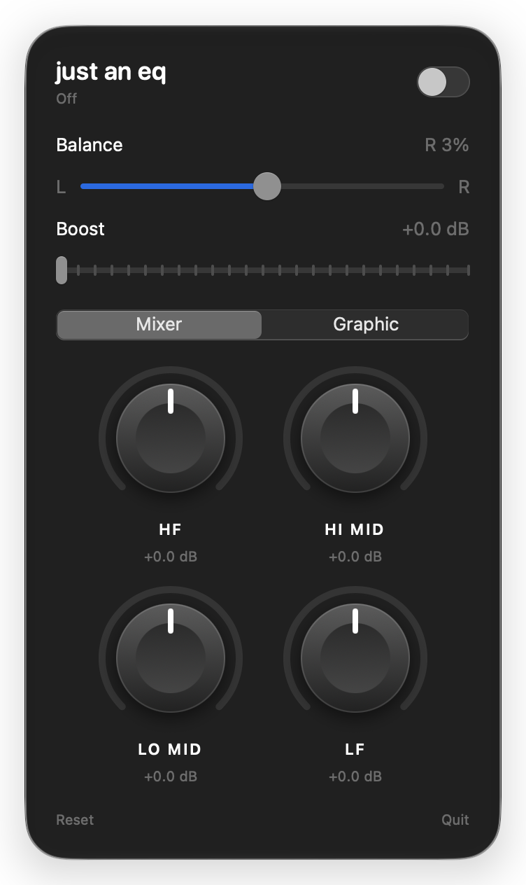

# just an eq

A tiny system-wide equalizer for macOS. It lives in the menu bar and shapes
everything your Mac plays: Spotify, YouTube, games, calls, on speakers,
headphones or Bluetooth.

<p align="center"></p>

- **Mixer mode**: four big rotary knobs like a DJ mixer (LF, Lo-Mid, Hi-Mid,
  HF). Cut down to a full kill, boost up to +6 dB. Double-click a knob to reset.
- **Graphic mode**: ten octave sliders from 31 Hz to 16 kHz (±12 dB) with presets.
- **Balance and boost**, plus a peak limiter so boosted audio doesn't clip.
- **Follows your output**: works with built-in speakers, wired and Bluetooth
  devices, including mono headset mode.
- **Global hotkey**: <kbd>⌃</kbd><kbd>⌥</kbd><kbd>⌘</kbd><kbd>E</kbd> toggles the EQ.
- No virtual audio driver, no kernel extension, no account, no network.
  About 400 KB.

## Requirements

macOS 14.2 or later. The download is for Apple silicon; on Intel Macs build from source.

## Install

### Download

Grab `JustAnEQ.dmg` from the [latest release](../../releases/latest), open it
and drag **JustAnEQ** into Applications.

The app is open source and not notarized by Apple, so macOS blocks the first
launch. Right-click the app → **Open** → **Open**, or run:

```bash
xattr -d com.apple.quarantine /Applications/JustAnEQ.app
```

### Build from source

Needs the Xcode Command Line Tools (`xcode-select --install`), no Xcode.

```bash
git clone https://github.com/loopmaster303/just-an-eq.git && just-an-eq/scripts/install.sh
```

This builds a release, installs it into `/Applications` and starts it.

On first use macOS asks for permission to capture system audio. The audio never
leaves your Mac; it is only filtered and played back.

## Usage

Launching the app opens the panel. Flip the switch to turn the EQ on. Click the
menu bar icon (or launch the app again) to bring the panel back.

If your menu bar is crowded, macOS may hide the icon behind the notch. The panel
still opens at the top right, and the hotkey always works.

## Windows and Linux

The same EQ as a small tray app, built from `src/desktop` (Rust). It does no
DSP of its own; the platform does:

- **Linux** needs PipeWire with WirePlumber (`pw-cli`, `pw-cat`, `wpctl`,
  `pw-dump` on the path). The app creates a filter-chain sink "just an eq",
  makes it the default output while On and plays the result on your real device.
  Switching Off restores the previous default.
- **Windows** needs [Equalizer APO](https://sourceforge.net/projects/equalizerapo/)
  installed once (admin, pick your playback device in its Configurator, reboot).
  The app writes `config\just-an-eq.txt` and adds one `Include:` line to
  Equalizer APO's `config.txt`.

Binaries come from the [latest release](../../releases/latest)
(`just-an-eq-linux-x86_64`, `just-an-eq-windows-x86_64.exe`), or build them:

```bash
cargo build --release --manifest-path src/desktop/Cargo.toml
```

Settings live in `~/.config/just-an-eq/settings.json` (Linux) or
`%APPDATA%\just-an-eq\settings.json` (Windows), same layout as on macOS.
Not in the desktop version: the limiter, the hotkey.

## How it works

A Core Audio process tap
captures the system mix, mutes the original, and plays it through a private
aggregate device on your current output. On the realtime thread each frame runs
through biquad filters (RBJ Audio EQ Cookbook), the gain stage and a limiter.
The UI hands parameters to the audio thread lock-free through a small C module,
so the audio callback never allocates or blocks.

```
src/JustAnEQ       app, menu bar panel, Core Audio engine (Swift, SwiftUI, AppKit)
src/JustAnEQCore   DSP: filters, presets, limiter (pure Swift, tested)
src/JustAnEQRT     lock-free parameter bridge to the audio thread (C)
tests/             Swift Testing suite
scripts/           build, test, bundle, dmg, install
```

## Development

```bash
scripts/test.sh      # run the test suite
scripts/bundle.sh    # build build/JustAnEQ.app
scripts/dmg.sh       # build build/JustAnEQ.dmg
```

## License

[MIT](LICENSE)
