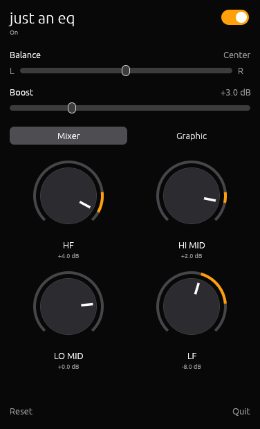

# just an eq

A tiny system-wide equalizer for macOS, Windows and Linux. It lives in the
menu bar or tray and shapes everything your computer plays: Spotify, YouTube,
games, calls, on speakers, headphones or Bluetooth.

<p align="center">



<br><sub>macOS · Windows · Linux</sub>
</p>

- **Mixer mode**: four big rotary knobs like a DJ mixer (LF, Lo-Mid, Hi-Mid,
  HF). Cut down to a full kill, boost up to +6 dB. Double-click a knob to reset.
- **Graphic mode**: ten octave sliders from 31 Hz to 16 kHz (±12 dB) with presets.
- **Balance and boost**, plus a peak limiter so boosted audio doesn't clip.
- **Follows your output**: works with built-in speakers, wired and Bluetooth
  devices, including mono headset mode.
- **Global hotkey** on macOS: <kbd>⌃</kbd><kbd>⌥</kbd><kbd>⌘</kbd><kbd>E</kbd> toggles the EQ.
- No virtual audio driver, no kernel extension, no account, no network.

Downloads for all three are on the [latest release](../../releases/latest):
`JustAnEQ.dmg` (macOS), `just-an-eq.exe` (Windows), `just-an-eq-linux-x86_64`
(Linux), plus `SHA256SUMS`.

## macOS

macOS 14.2 or later. The download is for Apple silicon; on Intel Macs build from source.

### Download

Grab `JustAnEQ.dmg` from the [latest release](../../releases/latest), open it
and drag **JustAnEQ** into Applications.

The app is open source and not notarized by Apple, so macOS blocks the first
launch. Right-click the app → **Open** → **Open**, or run:

```bash
xattr -d com.apple.quarantine /Applications/JustAnEQ.app
```

### Build from source

Needs the Xcode Command Line Tools (`xcode-select --install`), no Xcode.

```bash
git clone https://github.com/loopmaster303/just-an-eq.git && just-an-eq/scripts/install.sh
```

This builds a release, installs it into `/Applications` and starts it.

On first use macOS asks for permission to capture system audio. The audio never
leaves your Mac; it is only filtered and played back.

### Usage

Launching the app opens the panel. Flip the switch to turn the EQ on. Click the
menu bar icon (or launch the app again) to bring the panel back.

If your menu bar is crowded, macOS may hide the icon behind the notch. The panel
still opens at the top right, and the hotkey always works.

## Windows

Windows 10 or 11, 64-bit. Download `just-an-eq.exe` and run it. Windows
SmartScreen warns because the file is not code-signed: click **More info** →
**Run anyway**. The first start asks for admin rights once, then it:

- installs itself to `Program Files\just an eq`, with a Start Menu entry,
  autostart and an entry in Settings → Apps for uninstalling;
- sets up [Equalizer APO](https://sourceforge.net/projects/equalizerapo/)
  (GPL, bundled), which runs inside the Windows audio service and does the
  filtering, and switches it on for every active playback device;
- starts in the tray. Click the tray icon for the panel; close hides it.

Plug in headphones or a Bluetooth device later and the app registers them after
one more admin prompt; until then the panel says "not yet active on: …".
Uninstalling leaves Equalizer APO installed. The app writes
`config\just-an-eq.txt` and keeps its own block at the top of Equalizer APO's
`config.txt`; other lines in that file are left alone.

## Linux

x86_64 with PipeWire and WirePlumber (`pw-cli`, `pw-cat`, `wpctl`, `pw-dump`
on the path; any current desktop distribution has them). Download
`just-an-eq-linux-x86_64`, then:

```bash
chmod +x just-an-eq-linux-x86_64 && ./just-an-eq-linux-x86_64
```

The app creates a filter-chain sink "just an eq", makes it the default output
while On and plays the result on your real device; switching Off (or quitting)
restores the previous default. The tray icon uses the StatusNotifier protocol
(KDE, Hyprland bars, GNOME with the AppIndicator extension); without a tray
the window still works, close quits.

### Windows and Linux from source

The desktop app is one Rust crate in `src/desktop`:

```bash
cargo build --release --manifest-path src/desktop/Cargo.toml
```

For the Windows build, put `EqualizerAPO-x64-1.4.2.exe` into
`src/desktop/windows/` first (SHA-256
`7403be7427bbe1936a40dded082829b6e217fc4f5990fee5cba501f0ae055afa`); the
build bundles it. Cross-building from Linux works with `mingw-w64-gcc` and
`--target x86_64-pc-windows-gnu`.

Settings live in `~/.config/just-an-eq/settings.json` (Linux) or
`%APPDATA%\just-an-eq\settings.json` (Windows), same layout as on macOS.
Not in the desktop version: the limiter, the hotkey.

## How it works

**macOS:** a Core Audio process tap captures the system mix, mutes the
original, and plays it through a private aggregate device on your current
output. On the realtime thread each frame runs through biquad filters (RBJ
Audio EQ Cookbook), the gain stage and a limiter. The UI hands parameters to
the audio thread lock-free through a small C module, so the audio callback
never allocates or blocks.

**Windows and Linux:** the app does no DSP of its own. On Windows it writes
the same filters as an Equalizer APO configuration; on Linux it loads them into
a PipeWire filter-chain and sets its parameters live with `pw-cli`.

```
src/JustAnEQ       macOS app, menu bar panel, Core Audio engine (Swift, SwiftUI, AppKit)
src/JustAnEQCore   DSP: filters, presets, limiter (pure Swift, tested)
src/JustAnEQRT     lock-free parameter bridge to the audio thread (C)
src/desktop        Windows and Linux app (Rust, egui): UI, tray, Equalizer APO and PipeWire backends
tests/             Swift Testing suite
scripts/           build, test, bundle, dmg, install (macOS)
```

## Development

```bash
scripts/test.sh      # macOS test suite
scripts/bundle.sh    # build build/JustAnEQ.app
scripts/dmg.sh       # build build/JustAnEQ.dmg
cargo test --manifest-path src/desktop/Cargo.toml   # desktop app tests
```

## License

[MIT](LICENSE)
